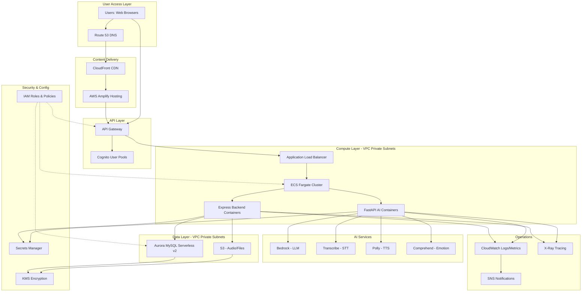
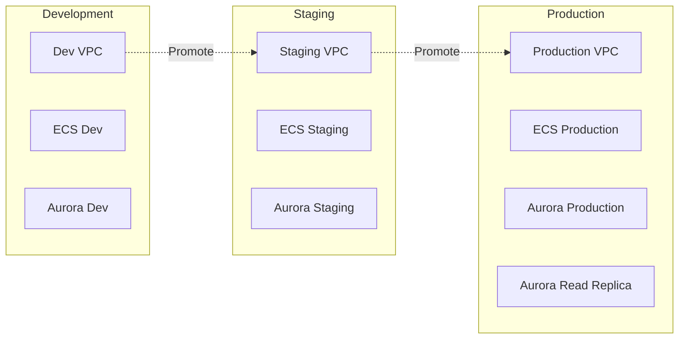
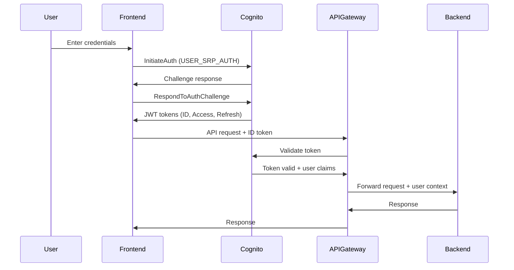
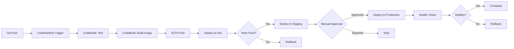

# Design Document: AWS Cloud Migration

## Overview

### Purpose

This design document specifies the technical architecture for migrating the MindCare Digital Mental Health Support Platform from local/traditional hosting to AWS cloud-native infrastructure. The migration replaces all local services and third-party APIs with AWS-managed equivalents while maintaining feature parity and improving scalability, security, and operational efficiency.

### Scope

The design encompasses:

- **Frontend Migration**: React application hosted on AWS Amplify with CloudFront CDN
- **Backend Migration**: Node.js Express and FastAPI services containerized on ECS Fargate behind API Gateway
- **Database Migration**: MySQL to Aurora MySQL Serverless v2 with automated scaling
- **AI Services Migration**: Google Gemini → Bedrock, OpenAI Whisper → Transcribe, gTTS → Polly, HuggingFace → Comprehend
- **Authentication Migration**: bcryptjs manual auth → AWS Cognito with JWT tokens
- **Security Infrastructure**: Secrets Manager, IAM roles, KMS encryption, VPC isolation
- **Operational Infrastructure**: CloudWatch monitoring, X-Ray tracing, CI/CD pipelines, disaster recovery

### Design Principles

1. **Cloud-Native Architecture**: Leverage AWS managed services to minimize operational overhead
2. **Security by Default**: Implement least-privilege access, encryption at rest/transit, network isolation
3. **Scalability**: Auto-scaling for compute (ECS Fargate) and database (Aurora Serverless v2)
4. **High Availability**: Multi-AZ deployment for critical components with automated failover
5. **Infrastructure as Code**: All resources defined in CloudFormation/Terraform for reproducibility
6. **Observability**: Comprehensive logging, metrics, tracing, and alerting
7. **Cost Optimization**: Right-sized resources with auto-scaling and Spot instances where appropriate


## Architecture

### High-Level Architecture



### Network Architecture

**VPC Configuration:**
- **CIDR Block**: 10.0.0.0/16
- **Availability Zones**: 3 AZs for high availability
- **Public Subnets**: 10.0.1.0/24, 10.0.2.0/24, 10.0.3.0/24 (ALB, NAT Gateways)
- **Private Subnets (Compute)**: 10.0.11.0/24, 10.0.12.0/24, 10.0.13.0/24 (ECS Fargate)
- **Private Subnets (Data)**: 10.0.21.0/24, 10.0.22.0/24, 10.0.23.0/24 (Aurora)

**Network Flow:**
1. Internet traffic → CloudFront → Amplify (static assets)
2. API traffic → API Gateway → ALB (public subnets) → ECS (private subnets)
3. ECS → Aurora (private data subnets, no internet access)
4. ECS → AWS Services via VPC Endpoints (no internet gateway)
5. ECS → Internet via NAT Gateway (for external dependencies only)

**Security Groups:**
- **ALB-SG**: Inbound 443 from API Gateway, Outbound to ECS-SG
- **ECS-SG**: Inbound from ALB-SG on container ports, Outbound to Aurora-SG and VPC Endpoints
- **Aurora-SG**: Inbound 3306 from ECS-SG only


### Deployment Architecture

**Multi-Environment Strategy:**



**Environment Characteristics:**
- **Development**: Single AZ, minimal resources, auto-shutdown after hours
- **Staging**: Multi-AZ, production-like configuration, continuous deployment
- **Production**: Multi-AZ, auto-scaling, manual approval for deployments, read replicas


## Components and Interfaces

### Frontend Component (AWS Amplify + CloudFront)

**Technology Stack:**
- React 18.x
- AWS Amplify Hosting
- CloudFront CDN
- Amplify Auth SDK for Cognito integration

**Component Responsibilities:**
- Serve static assets (HTML, CSS, JS, images)
- Handle client-side routing
- Integrate with Cognito for authentication
- Make API calls to API Gateway endpoints
- Store minimal session state in Cognito tokens

**Configuration:**
```javascript
// amplify-config.js
export const amplifyConfig = {
  Auth: {
    region: process.env.REACT_APP_AWS_REGION,
    userPoolId: process.env.REACT_APP_COGNITO_USER_POOL_ID,
    userPoolWebClientId: process.env.REACT_APP_COGNITO_CLIENT_ID,
    mandatorySignIn: true,
    authenticationFlowType: 'USER_SRP_AUTH'
  },
  API: {
    endpoints: [
      {
        name: 'MindCareAPI',
        endpoint: process.env.REACT_APP_API_GATEWAY_URL,
        region: process.env.REACT_APP_AWS_REGION
      }
    ]
  }
};
```

**CloudFront Configuration:**
- Origin: Amplify hosting endpoint
- Cache behavior: Cache static assets, forward auth headers
- SSL/TLS: Minimum TLS 1.2, ACM certificate
- Geo-restriction: None (global access)
- Custom error pages: 404 → /index.html (SPA routing)

**Interface:**
- **Input**: User HTTP requests (GET, POST, PUT, DELETE)
- **Output**: HTML/CSS/JS assets, API responses proxied from backend
- **Authentication**: Cognito JWT tokens in Authorization header


### API Gateway Component

**Configuration:**
- **Type**: REST API (not HTTP API for Cognito authorizer support)
- **Endpoint Type**: Regional
- **Authorization**: Cognito User Pool Authorizer
- **Throttling**: 10,000 requests/second burst, 5,000 steady state
- **Request Validation**: JSON schema validation enabled

**API Resources:**

```
/api/v1
├── /auth
│   ├── POST /login (Cognito integration)
│   ├── POST /register (Cognito integration)
│   ├── POST /refresh-token
│   └── POST /logout
├── /users
│   ├── GET /users/{userId}
│   ├── PUT /users/{userId}
│   └── GET /users/{userId}/preferences
├── /sessions
│   ├── POST /sessions (create counseling session)
│   ├── GET /sessions/{sessionId}
│   └── PUT /sessions/{sessionId}/status
├── /ai
│   ├── POST /ai/chat (Bedrock LLM)
│   ├── POST /ai/transcribe (Transcribe STT)
│   ├── POST /ai/synthesize (Polly TTS)
│   └── POST /ai/analyze-emotion (Comprehend)
└── /admin
    ├── GET /admin/users
    ├── PUT /admin/users/{userId}/role
    └── GET /admin/metrics
```

**Request/Response Models:**

```json
// POST /ai/chat Request
{
  "userId": "string",
  "message": "string",
  "context": {
    "sessionId": "string",
    "previousMessages": ["string"]
  }
}

// POST /ai/chat Response
{
  "response": "string",
  "confidence": 0.95,
  "timestamp": "2024-01-15T10:30:00Z",
  "modelId": "anthropic.claude-v2"
}
```

**Integration:**
- **Backend**: HTTP proxy to ALB endpoint
- **Authorization**: Cognito User Pool authorizer validates JWT tokens
- **CORS**: Enabled for Amplify origin domains
- **Logging**: CloudWatch Logs with full request/response logging


### ECS Fargate Backend Component

**Cluster Configuration:**
- **Compute**: AWS Fargate (serverless containers)
- **Task CPU**: 1 vCPU (1024 units)
- **Task Memory**: 2 GB
- **Auto-scaling**: Target tracking on CPU 70% and memory 80%
- **Min Tasks**: 2 (high availability)
- **Max Tasks**: 20 (cost control)

**Express Backend Service:**

**Container Specification:**
```dockerfile
# Dockerfile.express
FROM node:18-alpine AS builder
WORKDIR /app
COPY package*.json ./
RUN npm ci --only=production

FROM node:18-alpine
WORKDIR /app
COPY --from=builder /app/node_modules ./node_modules
COPY . .
EXPOSE 3000
HEALTHCHECK --interval=30s --timeout=3s --start-period=40s \
  CMD node healthcheck.js
CMD ["node", "server.js"]
```

**Task Definition:**
```json
{
  "family": "mindcare-express-backend",
  "networkMode": "awsvpc",
  "requiresCompatibilities": ["FARGATE"],
  "cpu": "1024",
  "memory": "2048",
  "taskRoleArn": "arn:aws:iam::ACCOUNT:role/ECSTaskRole",
  "executionRoleArn": "arn:aws:iam::ACCOUNT:role/ECSExecutionRole",
  "containerDefinitions": [{
    "name": "express-backend",
    "image": "ACCOUNT.dkr.ecr.REGION.amazonaws.com/mindcare-express:latest",
    "portMappings": [{"containerPort": 3000, "protocol": "tcp"}],
    "environment": [
      {"name": "NODE_ENV", "value": "production"},
      {"name": "AWS_REGION", "value": "us-east-1"}
    ],
    "secrets": [
      {"name": "DB_HOST", "valueFrom": "arn:aws:secretsmanager:REGION:ACCOUNT:secret:mindcare/db:host"},
      {"name": "DB_PASSWORD", "valueFrom": "arn:aws:secretsmanager:REGION:ACCOUNT:secret:mindcare/db:password"}
    ],
    "logConfiguration": {
      "logDriver": "awslogs",
      "options": {
        "awslogs-group": "/ecs/mindcare-express",
        "awslogs-region": "us-east-1",
        "awslogs-stream-prefix": "express"
      }
    },
    "healthCheck": {
      "command": ["CMD-SHELL", "curl -f http://localhost:3000/health || exit 1"],
      "interval": 30,
      "timeout": 5,
      "retries": 3,
      "startPeriod": 60
    }
  }]
}
```

**FastAPI AI Service:**

**Container Specification:**
```dockerfile
# Dockerfile.fastapi
FROM python:3.11-slim AS builder
WORKDIR /app
COPY requirements.txt .
RUN pip install --no-cache-dir -r requirements.txt

FROM python:3.11-slim
WORKDIR /app
COPY --from=builder /usr/local/lib/python3.11/site-packages /usr/local/lib/python3.11/site-packages
COPY . .
EXPOSE 8000
HEALTHCHECK --interval=30s --timeout=3s --start-period=40s \
  CMD python healthcheck.py
CMD ["uvicorn", "main:app", "--host", "0.0.0.0", "--port", "8000"]
```

**Service Responsibilities:**
- **Express Backend**: User management, session management, database operations, business logic
- **FastAPI AI Service**: AI service orchestration (Bedrock, Transcribe, Polly, Comprehend)

**Service Discovery:**
- ALB routes `/api/v1/ai/*` to FastAPI service
- ALB routes all other `/api/v1/*` to Express service
- Internal service-to-service communication via ALB DNS name


### AI Services Components

#### Bedrock (LLM Replacement for Google Gemini)

**Model Selection:**
- **Primary Model**: Anthropic Claude 3 Sonnet (anthropic.claude-3-sonnet-20240229-v1:0)
- **Fallback Model**: Amazon Titan Text Express (amazon.titan-text-express-v1)

**Integration Pattern:**
```python
import boto3
import json

bedrock_runtime = boto3.client('bedrock-runtime', region_name='us-east-1')

def generate_response(user_message: str, context: dict) -> dict:
    prompt = f"""You are a compassionate mental health support assistant.
    
User message: {user_message}
Context: {json.dumps(context)}

Provide a supportive, empathetic response."""

    request_body = {
        "anthropic_version": "bedrock-2023-05-31",
        "max_tokens": 1024,
        "messages": [
            {"role": "user", "content": prompt}
        ],
        "temperature": 0.7,
        "top_p": 0.9
    }
    
    response = bedrock_runtime.invoke_model(
        modelId='anthropic.claude-3-sonnet-20240229-v1:0',
        body=json.dumps(request_body)
    )
    
    response_body = json.loads(response['body'].read())
    return {
        "response": response_body['content'][0]['text'],
        "model": "claude-3-sonnet",
        "tokens_used": response_body['usage']['output_tokens']
    }
```

**Configuration:**
- **Timeout**: 30 seconds
- **Retry Strategy**: Exponential backoff, 3 retries
- **Error Handling**: Fallback to Titan model on Claude failure

#### Transcribe (STT Replacement for OpenAI Whisper)

**Service Configuration:**
- **Language**: English (en-US) with auto-detection
- **Audio Formats**: MP3, WAV, FLAC, OGG
- **Processing Mode**: Real-time streaming or batch from S3

**Integration Pattern:**
```python
import boto3

transcribe = boto3.client('transcribe', region_name='us-east-1')

def transcribe_audio(audio_s3_uri: str, job_name: str) -> dict:
    transcribe.start_transcription_job(
        TranscriptionJobName=job_name,
        Media={'MediaFileUri': audio_s3_uri},
        MediaFormat='mp3',
        LanguageCode='en-US',
        Settings={
            'ShowSpeakerLabels': True,
            'MaxSpeakerLabels': 2,
            'ChannelIdentification': False
        },
        OutputBucketName='mindcare-transcriptions'
    )
    
    # Poll for completion
    while True:
        status = transcribe.get_transcription_job(TranscriptionJobName=job_name)
        if status['TranscriptionJob']['TranscriptionJobStatus'] in ['COMPLETED', 'FAILED']:
            break
        time.sleep(5)
    
    if status['TranscriptionJob']['TranscriptionJobStatus'] == 'COMPLETED':
        transcript_uri = status['TranscriptionJob']['Transcript']['TranscriptFileUri']
        # Download and parse transcript
        return parse_transcript(transcript_uri)
    else:
        raise Exception("Transcription failed")
```

#### Polly (TTS Replacement for gTTS)

**Voice Configuration:**
- **Primary Voice**: Joanna (Neural, en-US, Female)
- **Alternative Voices**: Matthew (Neural, en-US, Male), Amy (Neural, en-GB, Female)
- **Engine**: Neural (higher quality than Standard)

**Integration Pattern:**
```python
import boto3

polly = boto3.client('polly', region_name='us-east-1')

def synthesize_speech(text: str, voice_id: str = 'Joanna') -> bytes:
    response = polly.synthesize_speech(
        Text=text,
        OutputFormat='mp3',
        VoiceId=voice_id,
        Engine='neural',
        TextType='text',
        SampleRate='24000'
    )
    
    audio_stream = response['AudioStream'].read()
    return audio_stream
```

**Storage:**
- Generated audio stored in S3 bucket: `mindcare-audio-output`
- Pre-signed URLs with 1-hour expiration for client access
- Lifecycle policy: Delete after 7 days

#### Comprehend (Emotion Detection Replacement for HuggingFace)

**Analysis Types:**
- **Sentiment Analysis**: Positive, Negative, Neutral, Mixed
- **Entity Recognition**: Person names, locations, dates
- **Key Phrases**: Important phrases in user text

**Integration Pattern:**
```python
import boto3

comprehend = boto3.client('comprehend', region_name='us-east-1')

def analyze_emotion(text: str) -> dict:
    # Sentiment analysis
    sentiment_response = comprehend.detect_sentiment(
        Text=text,
        LanguageCode='en'
    )
    
    # Key phrases
    phrases_response = comprehend.detect_key_phrases(
        Text=text,
        LanguageCode='en'
    )
    
    return {
        "sentiment": sentiment_response['Sentiment'],
        "sentiment_scores": sentiment_response['SentimentScore'],
        "key_phrases": [p['Text'] for p in phrases_response['KeyPhrases']],
        "confidence": sentiment_response['SentimentScore'][sentiment_response['Sentiment']]
    }
```

**Mapping to Existing Emotion Model:**
```python
def map_to_legacy_emotions(comprehend_result: dict) -> dict:
    """Map Comprehend sentiment to legacy emotion categories"""
    sentiment = comprehend_result['sentiment']
    scores = comprehend_result['sentiment_scores']
    
    # Map to legacy emotion format
    emotion_mapping = {
        'POSITIVE': {'joy': scores['Positive'], 'surprise': scores['Positive'] * 0.3},
        'NEGATIVE': {'sadness': scores['Negative'] * 0.5, 'anger': scores['Negative'] * 0.3, 'fear': scores['Negative'] * 0.2},
        'NEUTRAL': {'neutral': scores['Neutral']},
        'MIXED': {'mixed': scores['Mixed']}
    }
    
    return emotion_mapping.get(sentiment, {'neutral': 1.0})
```


### Authentication Component (AWS Cognito)

**User Pool Configuration:**
- **Pool Name**: mindcare-user-pool
- **Sign-in Options**: Email address
- **Password Policy**: Minimum 8 characters, require uppercase, lowercase, numbers, symbols
- **MFA**: Optional (SMS or TOTP)
- **Account Recovery**: Email verification code

**User Groups:**
```json
{
  "groups": [
    {
      "name": "USER",
      "description": "Standard platform users seeking mental health support",
      "precedence": 3
    },
    {
      "name": "COUNSELLOR",
      "description": "Licensed counselors providing support services",
      "precedence": 2
    },
    {
      "name": "ADMIN",
      "description": "Platform administrators with full access",
      "precedence": 1
    }
  ]
}
```

**Custom Attributes:**
```json
{
  "customAttributes": [
    {"name": "role", "type": "String", "mutable": true},
    {"name": "license_number", "type": "String", "mutable": true},
    {"name": "specialization", "type": "String", "mutable": true},
    {"name": "onboarding_completed", "type": "String", "mutable": true}
  ]
}
```

**Authentication Flow:**



**Token Structure:**
```json
// ID Token Claims
{
  "sub": "user-uuid",
  "email": "user@example.com",
  "cognito:groups": ["USER"],
  "custom:role": "USER",
  "email_verified": true,
  "iss": "https://cognito-idp.us-east-1.amazonaws.com/us-east-1_XXXXX",
  "exp": 1705334400,
  "iat": 1705330800
}
```

**Migration Strategy:**
```python
# Lambda function for user migration trigger
import bcrypt
import boto3

def lambda_handler(event, context):
    """Migrate users from legacy bcryptjs authentication"""
    
    if event['triggerSource'] == 'UserMigration_Authentication':
        username = event['userName']
        password = event['request']['password']
        
        # Query legacy database for user
        legacy_user = query_legacy_db(username)
        
        if legacy_user and bcrypt.checkpw(password.encode(), legacy_user['password_hash'].encode()):
            # User authenticated successfully, migrate to Cognito
            return {
                'response': {
                    'userAttributes': {
                        'email': legacy_user['email'],
                        'email_verified': 'true',
                        'custom:role': legacy_user['role']
                    },
                    'finalUserStatus': 'CONFIRMED',
                    'messageAction': 'SUPPRESS'
                }
            }
    
    raise Exception('User not found or invalid credentials')
```

**API Gateway Authorizer Configuration:**
```json
{
  "type": "COGNITO_USER_POOLS",
  "authorizerUri": "",
  "identitySource": "method.request.header.Authorization",
  "providerARNs": [
    "arn:aws:cognito-idp:us-east-1:ACCOUNT:userpool/us-east-1_XXXXX"
  ]
}
```


### Database Component (Aurora MySQL Serverless v2)

**Cluster Configuration:**
- **Engine**: Aurora MySQL 8.0.mysql_aurora.3.04.0 (compatible with MySQL 8.0.32)
- **Capacity**: 0.5 ACU minimum, 16 ACU maximum (auto-scaling)
- **Multi-AZ**: Enabled with automatic failover
- **Backup Retention**: 7 days
- **Encryption**: KMS encryption at rest
- **Performance Insights**: Enabled with 7-day retention

**Connection Configuration:**
```javascript
// Node.js connection pool
const mysql = require('mysql2/promise');
const AWS = require('aws-sdk');

const secretsManager = new AWS.SecretsManager({region: 'us-east-1'});

async function getDbCredentials() {
  const secret = await secretsManager.getSecretValue({
    SecretId: 'mindcare/db/credentials'
  }).promise();
  return JSON.parse(secret.SecretString);
}

async function createPool() {
  const credentials = await getDbCredentials();
  
  return mysql.createPool({
    host: credentials.host,
    port: credentials.port,
    user: credentials.username,
    password: credentials.password,
    database: 'mindcare',
    waitForConnections: true,
    connectionLimit: 10,
    queueLimit: 0,
    enableKeepAlive: true,
    keepAliveInitialDelay: 0,
    ssl: {
      rejectUnauthorized: true,
      ca: fs.readFileSync('./rds-ca-2019-root.pem')
    }
  });
}
```

**Parameter Group:**
```json
{
  "parameters": [
    {"name": "max_connections", "value": "1000"},
    {"name": "innodb_buffer_pool_size", "value": "{DBInstanceClassMemory*3/4}"},
    {"name": "slow_query_log", "value": "1"},
    {"name": "long_query_time", "value": "2"},
    {"name": "log_queries_not_using_indexes", "value": "1"},
    {"name": "character_set_server", "value": "utf8mb4"},
    {"name": "collation_server", "value": "utf8mb4_unicode_ci"}
  ]
}
```

**Secrets Manager Secret Structure:**
```json
{
  "engine": "mysql",
  "host": "mindcare-cluster.cluster-xxxxx.us-east-1.rds.amazonaws.com",
  "port": 3306,
  "username": "admin",
  "password": "GENERATED_PASSWORD",
  "dbname": "mindcare",
  "dbClusterIdentifier": "mindcare-cluster"
}
```

**Automatic Rotation:**
- **Rotation Lambda**: AWS-provided MySQL rotation function
- **Rotation Schedule**: Every 90 days
- **Rotation Strategy**: Alternating users (master user + rotation user)


### Security Components

#### Secrets Manager

**Secret Organization:**
```
/mindcare/
├── db/credentials (Aurora connection details)
├── api/keys (Third-party API keys if any)
├── jwt/secret (Legacy JWT secret for migration period)
└── encryption/keys (Application-level encryption keys)
```

**Access Pattern:**
```python
import boto3
import json
from functools import lru_cache

secrets_client = boto3.client('secretsmanager', region_name='us-east-1')

@lru_cache(maxsize=10)
def get_secret(secret_name: str) -> dict:
    """Retrieve secret with caching to reduce API calls"""
    try:
        response = secrets_client.get_secret_value(SecretId=secret_name)
        return json.loads(response['SecretString'])
    except Exception as e:
        logger.error(f"Failed to retrieve secret {secret_name}: {e}")
        raise
```

#### IAM Roles and Policies

**ECS Task Execution Role:**
```json
{
  "Version": "2012-10-17",
  "Statement": [
    {
      "Effect": "Allow",
      "Action": [
        "ecr:GetAuthorizationToken",
        "ecr:BatchCheckLayerAvailability",
        "ecr:GetDownloadUrlForLayer",
        "ecr:BatchGetImage"
      ],
      "Resource": "*"
    },
    {
      "Effect": "Allow",
      "Action": [
        "logs:CreateLogStream",
        "logs:PutLogEvents"
      ],
      "Resource": "arn:aws:logs:*:*:log-group:/ecs/mindcare-*"
    },
    {
      "Effect": "Allow",
      "Action": [
        "secretsmanager:GetSecretValue"
      ],
      "Resource": "arn:aws:secretsmanager:*:*:secret:mindcare/*"
    }
  ]
}
```

**ECS Task Role (Application Permissions):**
```json
{
  "Version": "2012-10-17",
  "Statement": [
    {
      "Effect": "Allow",
      "Action": [
        "bedrock:InvokeModel",
        "bedrock:InvokeModelWithResponseStream"
      ],
      "Resource": [
        "arn:aws:bedrock:*::foundation-model/anthropic.claude-*",
        "arn:aws:bedrock:*::foundation-model/amazon.titan-*"
      ]
    },
    {
      "Effect": "Allow",
      "Action": [
        "transcribe:StartTranscriptionJob",
        "transcribe:GetTranscriptionJob"
      ],
      "Resource": "*"
    },
    {
      "Effect": "Allow",
      "Action": [
        "polly:SynthesizeSpeech"
      ],
      "Resource": "*"
    },
    {
      "Effect": "Allow",
      "Action": [
        "comprehend:DetectSentiment",
        "comprehend:DetectKeyPhrases",
        "comprehend:DetectEntities"
      ],
      "Resource": "*"
    },
    {
      "Effect": "Allow",
      "Action": [
        "s3:GetObject",
        "s3:PutObject",
        "s3:DeleteObject"
      ],
      "Resource": [
        "arn:aws:s3:::mindcare-audio-input/*",
        "arn:aws:s3:::mindcare-audio-output/*",
        "arn:aws:s3:::mindcare-transcriptions/*"
      ]
    },
    {
      "Effect": "Allow",
      "Action": [
        "xray:PutTraceSegments",
        "xray:PutTelemetryRecords"
      ],
      "Resource": "*"
    }
  ]
}
```

**CI/CD Pipeline Role:**
```json
{
  "Version": "2012-10-17",
  "Statement": [
    {
      "Effect": "Allow",
      "Action": [
        "ecr:GetAuthorizationToken",
        "ecr:BatchCheckLayerAvailability",
        "ecr:PutImage",
        "ecr:InitiateLayerUpload",
        "ecr:UploadLayerPart",
        "ecr:CompleteLayerUpload"
      ],
      "Resource": "*"
    },
    {
      "Effect": "Allow",
      "Action": [
        "ecs:UpdateService",
        "ecs:DescribeServices",
        "ecs:DescribeTaskDefinition",
        "ecs:RegisterTaskDefinition"
      ],
      "Resource": "*"
    },
    {
      "Effect": "Allow",
      "Action": [
        "iam:PassRole"
      ],
      "Resource": [
        "arn:aws:iam::*:role/ECSTaskRole",
        "arn:aws:iam::*:role/ECSExecutionRole"
      ]
    }
  ]
}
```

#### KMS Encryption

**Key Configuration:**
```json
{
  "KeyPolicy": {
    "Version": "2012-10-17",
    "Statement": [
      {
        "Sid": "Enable IAM User Permissions",
        "Effect": "Allow",
        "Principal": {"AWS": "arn:aws:iam::ACCOUNT:root"},
        "Action": "kms:*",
        "Resource": "*"
      },
      {
        "Sid": "Allow Aurora to use the key",
        "Effect": "Allow",
        "Principal": {"Service": "rds.amazonaws.com"},
        "Action": [
          "kms:Decrypt",
          "kms:GenerateDataKey",
          "kms:CreateGrant"
        ],
        "Resource": "*"
      },
      {
        "Sid": "Allow S3 to use the key",
        "Effect": "Allow",
        "Principal": {"Service": "s3.amazonaws.com"},
        "Action": [
          "kms:Decrypt",
          "kms:GenerateDataKey"
        ],
        "Resource": "*"
      }
    ]
  },
  "KeyUsage": "ENCRYPT_DECRYPT",
  "KeySpec": "SYMMETRIC_DEFAULT",
  "MultiRegion": false
}
```


### Monitoring and Observability Components

#### CloudWatch Logs

**Log Groups:**
```
/ecs/mindcare-express (Express backend logs)
/ecs/mindcare-fastapi (FastAPI AI service logs)
/aws/apigateway/mindcare-api (API Gateway access logs)
/aws/lambda/cognito-migration (User migration logs)
/aws/rds/cluster/mindcare-cluster/error (Aurora error logs)
/aws/rds/cluster/mindcare-cluster/slowquery (Aurora slow query logs)
```

**Log Format (Structured JSON):**
```json
{
  "timestamp": "2024-01-15T10:30:00.123Z",
  "level": "INFO",
  "service": "express-backend",
  "traceId": "1-5f8a1234-abcdef1234567890",
  "userId": "user-uuid",
  "endpoint": "/api/v1/sessions",
  "method": "POST",
  "statusCode": 201,
  "duration": 145,
  "message": "Session created successfully"
}
```

**Log Retention:**
- Production: 30 days in CloudWatch, then archive to S3 Glacier
- Staging: 14 days
- Development: 7 days

#### CloudWatch Metrics

**Custom Metrics:**
```python
import boto3
from datetime import datetime

cloudwatch = boto3.client('cloudwatch', region_name='us-east-1')

def publish_metric(metric_name: str, value: float, unit: str, dimensions: dict):
    cloudwatch.put_metric_data(
        Namespace='MindCare/Application',
        MetricData=[{
            'MetricName': metric_name,
            'Value': value,
            'Unit': unit,
            'Timestamp': datetime.utcnow(),
            'Dimensions': [
                {'Name': k, 'Value': v} for k, v in dimensions.items()
            ]
        }]
    )

# Example usage
publish_metric(
    metric_name='AIResponseTime',
    value=1.23,
    unit='Seconds',
    dimensions={'Service': 'Bedrock', 'Model': 'Claude-3-Sonnet'}
)
```

**Key Metrics:**
- API Gateway: Request count, 4xx/5xx errors, latency (p50, p95, p99)
- ECS: CPU utilization, memory utilization, task count
- Aurora: Database connections, read/write IOPS, query latency
- AI Services: Invocation count, error rate, token usage (Bedrock)
- Custom: Session creation rate, user registration rate, AI response quality

#### CloudWatch Alarms

**Critical Alarms:**
```json
[
  {
    "AlarmName": "HighAPIErrorRate",
    "MetricName": "5XXError",
    "Namespace": "AWS/ApiGateway",
    "Statistic": "Sum",
    "Period": 300,
    "EvaluationPeriods": 2,
    "Threshold": 10,
    "ComparisonOperator": "GreaterThanThreshold",
    "AlarmActions": ["arn:aws:sns:us-east-1:ACCOUNT:critical-alerts"]
  },
  {
    "AlarmName": "HighDatabaseConnections",
    "MetricName": "DatabaseConnections",
    "Namespace": "AWS/RDS",
    "Statistic": "Average",
    "Period": 300,
    "EvaluationPeriods": 2,
    "Threshold": 800,
    "ComparisonOperator": "GreaterThanThreshold",
    "AlarmActions": ["arn:aws:sns:us-east-1:ACCOUNT:critical-alerts"]
  },
  {
    "AlarmName": "ECSServiceUnhealthy",
    "MetricName": "HealthyHostCount",
    "Namespace": "AWS/ApplicationELB",
    "Statistic": "Average",
    "Period": 60,
    "EvaluationPeriods": 2,
    "Threshold": 1,
    "ComparisonOperator": "LessThanThreshold",
    "AlarmActions": ["arn:aws:sns:us-east-1:ACCOUNT:critical-alerts"]
  }
]
```

#### X-Ray Tracing

**Integration:**
```javascript
// Express middleware
const AWSXRay = require('aws-xray-sdk-core');
const AWS = AWSXRay.captureAWS(require('aws-sdk'));
const http = AWSXRay.captureHTTPs(require('http'));

app.use(AWSXRay.express.openSegment('MindCareAPI'));

app.get('/api/v1/sessions/:id', async (req, res) => {
  const segment = AWSXRay.getSegment();
  const subsegment = segment.addNewSubsegment('DatabaseQuery');
  
  try {
    const session = await db.query('SELECT * FROM sessions WHERE id = ?', [req.params.id]);
    subsegment.close();
    res.json(session);
  } catch (error) {
    subsegment.addError(error);
    subsegment.close();
    throw error;
  }
});

app.use(AWSXRay.express.closeSegment());
```

**Service Map:**
- Visualizes request flow: API Gateway → ALB → ECS → Aurora
- Identifies bottlenecks and high-latency services
- Traces AI service invocations (Bedrock, Transcribe, Polly, Comprehend)


### CI/CD Pipeline Component

**Pipeline Architecture:**



**CodeBuild Buildspec (Express Backend):**
```yaml
version: 0.2

phases:
  pre_build:
    commands:
      - echo Logging in to Amazon ECR...
      - aws ecr get-login-password --region $AWS_REGION | docker login --username AWS --password-stdin $ECR_REGISTRY
      - COMMIT_HASH=$(echo $CODEBUILD_RESOLVED_SOURCE_VERSION | cut -c 1-7)
      - IMAGE_TAG=${COMMIT_HASH:=latest}
  
  build:
    commands:
      - echo Running tests...
      - npm ci
      - npm run test
      - npm run lint
      - echo Building Docker image...
      - docker build -t $ECR_REGISTRY/mindcare-express:$IMAGE_TAG -f Dockerfile.express .
      - docker tag $ECR_REGISTRY/mindcare-express:$IMAGE_TAG $ECR_REGISTRY/mindcare-express:latest
  
  post_build:
    commands:
      - echo Pushing Docker image...
      - docker push $ECR_REGISTRY/mindcare-express:$IMAGE_TAG
      - docker push $ECR_REGISTRY/mindcare-express:latest
      - echo Writing image definitions file...
      - printf '[{"name":"express-backend","imageUri":"%s"}]' $ECR_REGISTRY/mindcare-express:$IMAGE_TAG > imagedefinitions.json

artifacts:
  files:
    - imagedefinitions.json
```

**Deployment Strategy:**
- **Blue/Green Deployment**: Zero-downtime deployments with automatic rollback
- **Health Check Grace Period**: 60 seconds for container startup
- **Deployment Circuit Breaker**: Automatic rollback on 2 consecutive health check failures

**CodePipeline Stages:**
```json
{
  "stages": [
    {
      "name": "Source",
      "actions": [{
        "name": "SourceAction",
        "actionTypeId": {
          "category": "Source",
          "owner": "AWS",
          "provider": "CodeCommit",
          "version": "1"
        },
        "configuration": {
          "RepositoryName": "mindcare-backend",
          "BranchName": "main"
        }
      }]
    },
    {
      "name": "Build",
      "actions": [{
        "name": "BuildAction",
        "actionTypeId": {
          "category": "Build",
          "owner": "AWS",
          "provider": "CodeBuild",
          "version": "1"
        },
        "configuration": {
          "ProjectName": "mindcare-build"
        }
      }]
    },
    {
      "name": "DeployToDev",
      "actions": [{
        "name": "DeployAction",
        "actionTypeId": {
          "category": "Deploy",
          "owner": "AWS",
          "provider": "ECS",
          "version": "1"
        },
        "configuration": {
          "ClusterName": "mindcare-dev",
          "ServiceName": "mindcare-express-dev",
          "FileName": "imagedefinitions.json"
        }
      }]
    },
    {
      "name": "DeployToStaging",
      "actions": [{
        "name": "DeployAction",
        "actionTypeId": {
          "category": "Deploy",
          "owner": "AWS",
          "provider": "ECS",
          "version": "1"
        },
        "configuration": {
          "ClusterName": "mindcare-staging",
          "ServiceName": "mindcare-express-staging",
          "FileName": "imagedefinitions.json"
        }
      }]
    },
    {
      "name": "ApprovalForProduction",
      "actions": [{
        "name": "ManualApproval",
        "actionTypeId": {
          "category": "Approval",
          "owner": "AWS",
          "provider": "Manual",
          "version": "1"
        },
        "configuration": {
          "CustomData": "Review staging deployment before production release"
        }
      }]
    },
    {
      "name": "DeployToProduction",
      "actions": [{
        "name": "DeployAction",
        "actionTypeId": {
          "category": "Deploy",
          "owner": "AWS",
          "provider": "ECS",
          "version": "1"
        },
        "configuration": {
          "ClusterName": "mindcare-production",
          "ServiceName": "mindcare-express-production",
          "FileName": "imagedefinitions.json",
          "DeploymentConfiguration": "CodeDeployDefault.ECSAllAtOnce"
        }
      }]
    }
  ]
}
```


## Data Models

### Aurora Database Schema

**Users Table:**
```sql
CREATE TABLE users (
    id VARCHAR(36) PRIMARY KEY,
    cognito_sub VARCHAR(255) UNIQUE NOT NULL,
    email VARCHAR(255) UNIQUE NOT NULL,
    role ENUM('USER', 'COUNSELLOR', 'ADMIN') NOT NULL DEFAULT 'USER',
    first_name VARCHAR(100),
    last_name VARCHAR(100),
    phone VARCHAR(20),
    date_of_birth DATE,
    license_number VARCHAR(50),
    specialization VARCHAR(100),
    onboarding_completed BOOLEAN DEFAULT FALSE,
    created_at TIMESTAMP DEFAULT CURRENT_TIMESTAMP,
    updated_at TIMESTAMP DEFAULT CURRENT_TIMESTAMP ON UPDATE CURRENT_TIMESTAMP,
    last_login TIMESTAMP,
    is_active BOOLEAN DEFAULT TRUE,
    INDEX idx_cognito_sub (cognito_sub),
    INDEX idx_email (email),
    INDEX idx_role (role)
) ENGINE=InnoDB DEFAULT CHARSET=utf8mb4 COLLATE=utf8mb4_unicode_ci;
```

**Sessions Table:**
```sql
CREATE TABLE sessions (
    id VARCHAR(36) PRIMARY KEY,
    user_id VARCHAR(36) NOT NULL,
    counsellor_id VARCHAR(36),
    session_type ENUM('CHAT', 'VOICE', 'VIDEO') NOT NULL,
    status ENUM('SCHEDULED', 'IN_PROGRESS', 'COMPLETED', 'CANCELLED') NOT NULL DEFAULT 'SCHEDULED',
    scheduled_at TIMESTAMP,
    started_at TIMESTAMP,
    ended_at TIMESTAMP,
    duration_minutes INT,
    notes TEXT,
    created_at TIMESTAMP DEFAULT CURRENT_TIMESTAMP,
    updated_at TIMESTAMP DEFAULT CURRENT_TIMESTAMP ON UPDATE CURRENT_TIMESTAMP,
    FOREIGN KEY (user_id) REFERENCES users(id) ON DELETE CASCADE,
    FOREIGN KEY (counsellor_id) REFERENCES users(id) ON DELETE SET NULL,
    INDEX idx_user_id (user_id),
    INDEX idx_counsellor_id (counsellor_id),
    INDEX idx_status (status),
    INDEX idx_scheduled_at (scheduled_at)
) ENGINE=InnoDB DEFAULT CHARSET=utf8mb4 COLLATE=utf8mb4_unicode_ci;
```

**Messages Table:**
```sql
CREATE TABLE messages (
    id VARCHAR(36) PRIMARY KEY,
    session_id VARCHAR(36) NOT NULL,
    sender_id VARCHAR(36) NOT NULL,
    sender_type ENUM('USER', 'COUNSELLOR', 'AI') NOT NULL,
    message_type ENUM('TEXT', 'AUDIO', 'SYSTEM') NOT NULL DEFAULT 'TEXT',
    content TEXT NOT NULL,
    audio_s3_key VARCHAR(500),
    sentiment VARCHAR(20),
    sentiment_score DECIMAL(3,2),
    emotion_data JSON,
    created_at TIMESTAMP DEFAULT CURRENT_TIMESTAMP,
    FOREIGN KEY (session_id) REFERENCES sessions(id) ON DELETE CASCADE,
    FOREIGN KEY (sender_id) REFERENCES users(id) ON DELETE CASCADE,
    INDEX idx_session_id (session_id),
    INDEX idx_sender_id (sender_id),
    INDEX idx_created_at (created_at)
) ENGINE=InnoDB DEFAULT CHARSET=utf8mb4 COLLATE=utf8mb4_unicode_ci;
```

**User Preferences Table:**
```sql
CREATE TABLE user_preferences (
    id VARCHAR(36) PRIMARY KEY,
    user_id VARCHAR(36) NOT NULL,
    preference_key VARCHAR(100) NOT NULL,
    preference_value TEXT NOT NULL,
    created_at TIMESTAMP DEFAULT CURRENT_TIMESTAMP,
    updated_at TIMESTAMP DEFAULT CURRENT_TIMESTAMP ON UPDATE CURRENT_TIMESTAMP,
    FOREIGN KEY (user_id) REFERENCES users(id) ON DELETE CASCADE,
    UNIQUE KEY unique_user_preference (user_id, preference_key),
    INDEX idx_user_id (user_id)
) ENGINE=InnoDB DEFAULT CHARSET=utf8mb4 COLLATE=utf8mb4_unicode_ci;
```

**AI Interactions Table:**
```sql
CREATE TABLE ai_interactions (
    id VARCHAR(36) PRIMARY KEY,
    session_id VARCHAR(36) NOT NULL,
    user_id VARCHAR(36) NOT NULL,
    service_type ENUM('BEDROCK', 'TRANSCRIBE', 'POLLY', 'COMPREHEND') NOT NULL,
    request_data JSON NOT NULL,
    response_data JSON NOT NULL,
    model_id VARCHAR(100),
    tokens_used INT,
    latency_ms INT,
    cost_usd DECIMAL(10,6),
    created_at TIMESTAMP DEFAULT CURRENT_TIMESTAMP,
    FOREIGN KEY (session_id) REFERENCES sessions(id) ON DELETE CASCADE,
    FOREIGN KEY (user_id) REFERENCES users(id) ON DELETE CASCADE,
    INDEX idx_session_id (session_id),
    INDEX idx_user_id (user_id),
    INDEX idx_service_type (service_type),
    INDEX idx_created_at (created_at)
) ENGINE=InnoDB DEFAULT CHARSET=utf8mb4 COLLATE=utf8mb4_unicode_ci;
```

### S3 Bucket Structure

**Audio Input Bucket (mindcare-audio-input):**
```
/sessions/{session_id}/
  ├── input/{timestamp}_{user_id}.mp3
  └── metadata/{timestamp}_{user_id}.json
```

**Audio Output Bucket (mindcare-audio-output):**
```
/sessions/{session_id}/
  ├── output/{timestamp}_response.mp3
  └── metadata/{timestamp}_response.json
```

**Transcriptions Bucket (mindcare-transcriptions):**
```
/sessions/{session_id}/
  └── {job_id}_transcript.json
```

**Lifecycle Policies:**
```json
{
  "Rules": [
    {
      "Id": "DeleteOldAudio",
      "Status": "Enabled",
      "Prefix": "",
      "Expiration": {
        "Days": 90
      }
    },
    {
      "Id": "TransitionToGlacier",
      "Status": "Enabled",
      "Prefix": "",
      "Transitions": [
        {
          "Days": 30,
          "StorageClass": "GLACIER"
        }
      ]
    }
  ]
}
```

### API Data Models

**Session Creation Request:**
```typescript
interface CreateSessionRequest {
  userId: string;
  counsellorId?: string;
  sessionType: 'CHAT' | 'VOICE' | 'VIDEO';
  scheduledAt?: string; // ISO 8601 timestamp
  notes?: string;
}
```

**Session Response:**
```typescript
interface SessionResponse {
  id: string;
  userId: string;
  counsellorId?: string;
  sessionType: 'CHAT' | 'VOICE' | 'VIDEO';
  status: 'SCHEDULED' | 'IN_PROGRESS' | 'COMPLETED' | 'CANCELLED';
  scheduledAt?: string;
  startedAt?: string;
  endedAt?: string;
  durationMinutes?: number;
  notes?: string;
  createdAt: string;
  updatedAt: string;
}
```

**AI Chat Request:**
```typescript
interface AIChatRequest {
  userId: string;
  sessionId: string;
  message: string;
  context?: {
    previousMessages?: string[];
    emotionalState?: string;
  };
}
```

**AI Chat Response:**
```typescript
interface AIChatResponse {
  response: string;
  confidence: number;
  timestamp: string;
  modelId: string;
  tokensUsed: number;
  sentiment?: {
    sentiment: 'POSITIVE' | 'NEGATIVE' | 'NEUTRAL' | 'MIXED';
    scores: {
      positive: number;
      negative: number;
      neutral: number;
      mixed: number;
    };
  };
}
```

**Transcription Request:**
```typescript
interface TranscriptionRequest {
  userId: string;
  sessionId: string;
  audioS3Key: string;
  audioFormat: 'mp3' | 'wav' | 'flac' | 'ogg';
}
```

**Transcription Response:**
```typescript
interface TranscriptionResponse {
  jobId: string;
  status: 'IN_PROGRESS' | 'COMPLETED' | 'FAILED';
  transcript?: string;
  confidence?: number;
  timestamps?: Array<{
    text: string;
    startTime: number;
    endTime: number;
  }>;
}
```


## Correctness Properties

A property is a characteristic or behavior that should hold true across all valid executions of a system—essentially, a formal statement about what the system should do. Properties serve as the bridge between human-readable specifications and machine-verifiable correctness guarantees.

### Property Reflection

After analyzing all 120 acceptance criteria, I identified the following testable properties. Many criteria are infrastructure configuration checks (examples) rather than universal properties. The properties below represent behaviors that should hold across all valid inputs and executions.

**Redundancy Analysis:**
- Auto-scaling properties (2.3, 3.2, 20.2) all test similar behavior but for different services - kept separate as they test different components
- Authentication/authorization properties (2.4, 8.5) test similar concepts but at different layers - combined into comprehensive auth property
- Migration data integrity properties (3.5, 18.1, 18.2, 18.3) all relate to data preservation - combined into comprehensive migration property
- Performance properties (20.3, 20.4) test similar concepts for different layers - kept separate as they have different SLAs

### Property 1: ECS Auto-Scaling Under Load

For any ECS service with auto-scaling enabled, when request volume increases beyond the target CPU/memory threshold, the number of running tasks should automatically increase without manual intervention.

**Validates: Requirements 2.3**

### Property 2: Aurora Auto-Scaling Under Load

For any Aurora Serverless v2 cluster, when database workload increases beyond current ACU capacity, the cluster should automatically scale up ACUs without connection interruption.

**Validates: Requirements 3.2**

### Property 3: Data Migration Integrity

For any table in the source MySQL database, after migration to Aurora:
- Row count should match exactly
- All foreign key relationships should be preserved
- Data checksums should match for all rows
- All indexes should exist with the same structure

**Validates: Requirements 3.5, 18.1, 18.2, 18.3**

### Property 4: API Authentication and Authorization

For any API request to protected endpoints:
- If the request has no Authorization header, API Gateway should return 401 Unauthorized
- If the request has an invalid JWT token, API Gateway should return 401 Unauthorized
- If the request has a valid JWT token but insufficient permissions, API Gateway should return 403 Forbidden
- If the request has a valid JWT token with sufficient permissions, API Gateway should forward to backend

**Validates: Requirements 2.4, 8.5**

### Property 5: Bedrock Prompt Format Compatibility

For any prompt format that was valid for Google Gemini API, the Bedrock integration should accept the same format (after transformation) and return a response with the same structure (response text, confidence, timestamp).

**Validates: Requirements 4.4**

### Property 6: Transcribe Audio Format Support

For any audio file in a supported format (mp3, wav, flac, ogg), when submitted to Transcribe service, the service should return a transcript with text and timestamps without format-related errors.

**Validates: Requirements 5.2, 5.4**

### Property 7: Polly Voice and Language Support

For any voice and language combination that was supported by gTTS, the Polly integration should support the same combination and generate audio output.

**Validates: Requirements 6.4**

### Property 8: Comprehend Sentiment Analysis

For any text input, when analyzed by Comprehend, the service should return:
- A sentiment classification (POSITIVE, NEGATIVE, NEUTRAL, or MIXED)
- Confidence scores for each sentiment category
- The response should be mappable to the legacy emotion format

**Validates: Requirements 7.2, 7.4**

### Property 9: Cognito User Registration

For any valid user registration request (valid email, password meeting policy), Cognito should:
- Create a user account
- Send an email verification message
- Return a user ID
- Set the user's email_verified status to false until verified

**Validates: Requirements 8.3**

### Property 10: Cognito Authentication Token Issuance

For any valid login request (correct email and password), Cognito should return:
- An ID token (JWT)
- An access token (JWT)
- A refresh token
- All tokens should be valid and verifiable

**Validates: Requirements 8.4**

### Property 11: User Account Migration

For any user account in the legacy bcryptjs system, after migration to Cognito:
- The user should exist in Cognito user pool
- The user should be able to log in with their existing password
- The user's role and attributes should be preserved

**Validates: Requirements 8.6**

### Property 12: Secrets Migration Completeness

For any secret value in legacy dotenv files, after migration:
- The secret should exist in AWS Secrets Manager
- The secret value should match the original value
- The secret should not appear in any code, configuration files, or environment variables

**Validates: Requirements 9.3**

### Property 13: Build Log Secret Protection

For any build execution in the CI/CD pipeline, when scanning build logs:
- No secret values from Secrets Manager should appear in logs
- No database passwords should appear in logs
- No API keys should appear in logs

**Validates: Requirements 9.5**

### Property 14: Container Health Check Responsiveness

For any running ECS container, when a health check request is sent to the health endpoint:
- The container should respond within 5 seconds
- The response should indicate healthy status (HTTP 200)
- The response should include basic health information (uptime, dependencies status)

**Validates: Requirements 10.6**

### Property 15: Structured Logging Format

For any log entry generated by ECS containers, the log should:
- Be valid JSON
- Contain required fields: timestamp, level, service, message
- Contain optional fields when available: traceId, userId, endpoint, statusCode, duration

**Validates: Requirements 13.1**

### Property 16: CloudWatch Alerting on Error Threshold

For any monitored service, when error rate exceeds the configured threshold for the evaluation period:
- CloudWatch should trigger an alarm
- SNS should send notifications to configured administrators
- The alarm should include relevant context (service name, error count, time period)

**Validates: Requirements 13.3**

### Property 17: CI/CD Build and Push on Test Success

For any code commit that passes all tests (unit, integration, security scans):
- The pipeline should build a container image
- The image should be tagged with commit hash
- The image should be pushed to ECR
- The image should be scannable for vulnerabilities

**Validates: Requirements 14.3**

### Property 18: Deployment Health Check Validation

For any deployment to an ECS service:
- After deployment completes, health checks should be performed
- If health checks fail, the deployment should be marked as failed
- If health checks pass, the deployment should be marked as successful
- Health check results should be logged

**Validates: Requirements 14.5**

### Property 19: Deployment Rollback on Failure

For any failed deployment (health checks fail or deployment errors):
- The system should automatically initiate rollback
- The previous container image version should be redeployed
- The service should return to the previous stable state
- Rollback completion should be verified with health checks

**Validates: Requirements 14.6**

### Property 20: Resource Cost Allocation Tagging

For any AWS resource created by infrastructure templates:
- The resource should have a "Project" tag with value "MindCare"
- The resource should have an "Environment" tag (dev, staging, or production)
- The resource should have a "ManagedBy" tag with value "Terraform" or "CloudFormation"
- The resource should have a "CostCenter" tag for expense tracking

**Validates: Requirements 16.6**

### Property 21: API Gateway Rate Limiting

For any client making requests to API Gateway:
- When request rate exceeds the configured burst limit (10,000 req/s), subsequent requests should receive 429 Too Many Requests
- When request rate exceeds the steady-state limit (5,000 req/s), subsequent requests should be throttled
- Rate limiting should be per-client (based on API key or IP)

**Validates: Requirements 17.4**

### Property 22: Application Query Functional Validation

For any critical application query (user lookup, session retrieval, message history):
- The query should return the same results when executed against the migrated Aurora database as it did against the local MySQL database
- Query performance should be within acceptable bounds (< 100ms for simple queries)

**Validates: Requirements 18.4**

### Property 23: User Preference Cross-Device Synchronization

For any user preference change made on one device:
- The preference should be stored in Aurora database or S3
- When the user accesses the application from another device, the updated preference should be visible
- Synchronization should occur within 5 seconds of the change

**Validates: Requirements 19.3**

### Property 24: User Data Migration from localStorage

For any active user with data in localStorage:
- All localStorage data should be migrated to cloud storage (Aurora or S3)
- After migration, the user should be able to access their data from any device
- No data should be lost during migration

**Validates: Requirements 19.4**

### Property 25: Offline Data Synchronization

For any user action performed while offline:
- The action should be cached locally
- When connectivity is restored, the cached action should be synchronized to the backend
- Synchronization should complete without data loss or duplication

**Validates: Requirements 19.5**

### Property 26: ECS Auto-Scaling Performance

For any load test simulating increasing user concurrency:
- ECS should automatically scale from minimum to higher task counts
- Scaling should occur within 2 minutes of sustained high load
- No requests should fail due to insufficient capacity during scale-up

**Validates: Requirements 20.2**

### Property 27: API Gateway Response Time SLA

For any set of API requests under normal load conditions (< 1000 concurrent users):
- 95% of requests should complete in under 500ms
- 99% of requests should complete in under 1000ms
- Response times should be measured from API Gateway to client

**Validates: Requirements 20.3**

### Property 28: Aurora Query Performance SLA

For any set of database queries under normal load conditions (< 500 concurrent connections):
- 95% of queries should complete in under 100ms
- 99% of queries should complete in under 250ms
- Query times should be measured from query submission to result return

**Validates: Requirements 20.4**


## Error Handling

### Error Categories

**1. Infrastructure Errors**
- Service unavailability (AWS service outages)
- Resource limits exceeded (ECS task limits, Aurora connection limits)
- Network connectivity issues (VPC routing, security group misconfigurations)

**2. Authentication/Authorization Errors**
- Invalid or expired JWT tokens
- Insufficient permissions for requested operations
- Cognito service errors (user not found, password policy violations)

**3. Data Errors**
- Database connection failures
- Query timeouts
- Data validation failures
- Foreign key constraint violations

**4. AI Service Errors**
- Bedrock model invocation failures
- Transcribe job failures (unsupported audio format, corrupted audio)
- Polly synthesis failures (text too long, unsupported language)
- Comprehend analysis failures (text too short, unsupported language)

**5. Migration Errors**
- Data export failures
- Schema mismatch during import
- Data integrity validation failures
- Rollback failures

### Error Handling Strategies

#### API Gateway Error Responses

```json
{
  "errorResponse": {
    "statusCode": 400,
    "error": "BadRequest",
    "message": "Invalid request parameters",
    "details": {
      "field": "email",
      "issue": "Invalid email format"
    },
    "requestId": "req-uuid",
    "timestamp": "2024-01-15T10:30:00Z"
  }
}
```

**Status Code Mapping:**
- 400: Bad Request (invalid input)
- 401: Unauthorized (missing or invalid token)
- 403: Forbidden (insufficient permissions)
- 404: Not Found (resource doesn't exist)
- 429: Too Many Requests (rate limit exceeded)
- 500: Internal Server Error (unexpected backend error)
- 502: Bad Gateway (backend service unavailable)
- 503: Service Unavailable (temporary service disruption)
- 504: Gateway Timeout (backend timeout)

#### Backend Error Handling

```javascript
// Express error handling middleware
app.use((err, req, res, next) => {
  const errorId = uuidv4();
  
  // Log error with context
  logger.error({
    errorId,
    error: err.message,
    stack: err.stack,
    userId: req.user?.id,
    endpoint: req.path,
    method: req.method,
    traceId: req.headers['x-amzn-trace-id']
  });
  
  // Publish error metric
  publishMetric('ApplicationError', 1, 'Count', {
    Service: 'Express',
    ErrorType: err.name,
    Endpoint: req.path
  });
  
  // Return sanitized error to client
  if (err.statusCode && err.statusCode < 500) {
    // Client error - safe to return details
    res.status(err.statusCode).json({
      error: err.name,
      message: err.message,
      errorId
    });
  } else {
    // Server error - return generic message
    res.status(500).json({
      error: 'InternalServerError',
      message: 'An unexpected error occurred',
      errorId
    });
  }
});
```

#### Database Error Handling

```javascript
async function executeQuery(query, params) {
  const maxRetries = 3;
  let attempt = 0;
  
  while (attempt < maxRetries) {
    try {
      const [rows] = await pool.execute(query, params);
      return rows;
    } catch (error) {
      attempt++;
      
      // Check if error is retryable
      if (isRetryableError(error) && attempt < maxRetries) {
        const backoffMs = Math.pow(2, attempt) * 1000;
        logger.warn({
          message: 'Database query failed, retrying',
          attempt,
          backoffMs,
          error: error.message
        });
        await sleep(backoffMs);
      } else {
        // Non-retryable error or max retries exceeded
        logger.error({
          message: 'Database query failed',
          query,
          error: error.message,
          code: error.code
        });
        throw new DatabaseError('Query execution failed', error);
      }
    }
  }
}

function isRetryableError(error) {
  const retryableCodes = [
    'ER_LOCK_DEADLOCK',
    'ER_LOCK_WAIT_TIMEOUT',
    'ECONNRESET',
    'ETIMEDOUT',
    'PROTOCOL_CONNECTION_LOST'
  ];
  return retryableCodes.includes(error.code);
}
```

#### AI Service Error Handling

```python
import boto3
from botocore.exceptions import ClientError
import time

def invoke_bedrock_with_retry(prompt: str, max_retries: int = 3) -> dict:
    """Invoke Bedrock with exponential backoff retry"""
    bedrock = boto3.client('bedrock-runtime')
    
    for attempt in range(max_retries):
        try:
            response = bedrock.invoke_model(
                modelId='anthropic.claude-3-sonnet-20240229-v1:0',
                body=json.dumps({
                    "anthropic_version": "bedrock-2023-05-31",
                    "max_tokens": 1024,
                    "messages": [{"role": "user", "content": prompt}]
                })
            )
            return json.loads(response['body'].read())
            
        except ClientError as e:
            error_code = e.response['Error']['Code']
            
            # Check if error is retryable
            if error_code in ['ThrottlingException', 'ServiceUnavailableException']:
                if attempt < max_retries - 1:
                    backoff = (2 ** attempt) * 1.0
                    logger.warning(f"Bedrock throttled, retrying in {backoff}s")
                    time.sleep(backoff)
                else:
                    logger.error("Bedrock max retries exceeded")
                    raise AIServiceError("Bedrock service unavailable")
            
            elif error_code == 'ValidationException':
                # Non-retryable validation error
                logger.error(f"Bedrock validation error: {e}")
                raise AIServiceError("Invalid prompt format")
            
            else:
                # Unknown error
                logger.error(f"Bedrock error: {error_code}")
                raise AIServiceError(f"Bedrock invocation failed: {error_code}")
```

#### Circuit Breaker Pattern

```javascript
class CircuitBreaker {
  constructor(service, threshold = 5, timeout = 60000) {
    this.service = service;
    this.failureThreshold = threshold;
    this.timeout = timeout;
    this.failureCount = 0;
    this.lastFailureTime = null;
    this.state = 'CLOSED'; // CLOSED, OPEN, HALF_OPEN
  }
  
  async execute(operation) {
    if (this.state === 'OPEN') {
      if (Date.now() - this.lastFailureTime > this.timeout) {
        this.state = 'HALF_OPEN';
      } else {
        throw new Error(`Circuit breaker OPEN for ${this.service}`);
      }
    }
    
    try {
      const result = await operation();
      this.onSuccess();
      return result;
    } catch (error) {
      this.onFailure();
      throw error;
    }
  }
  
  onSuccess() {
    this.failureCount = 0;
    this.state = 'CLOSED';
  }
  
  onFailure() {
    this.failureCount++;
    this.lastFailureTime = Date.now();
    
    if (this.failureCount >= this.failureThreshold) {
      this.state = 'OPEN';
      logger.error({
        message: 'Circuit breaker opened',
        service: this.service,
        failureCount: this.failureCount
      });
    }
  }
}

// Usage
const bedrockCircuitBreaker = new CircuitBreaker('Bedrock', 5, 60000);

async function callBedrock(prompt) {
  return bedrockCircuitBreaker.execute(async () => {
    return await invokeBedrock(prompt);
  });
}
```

### Migration Error Handling

**Pre-Migration Validation:**
```bash
#!/bin/bash
# Pre-migration validation script

echo "Validating source database..."

# Check database connectivity
mysql -h localhost -u root -p$DB_PASSWORD -e "SELECT 1" || exit 1

# Check table counts
TABLE_COUNT=$(mysql -h localhost -u root -p$DB_PASSWORD mindcare -e "SELECT COUNT(*) FROM information_schema.tables WHERE table_schema='mindcare'" -s)
echo "Source tables: $TABLE_COUNT"

# Check for foreign key constraints
FK_COUNT=$(mysql -h localhost -u root -p$DB_PASSWORD mindcare -e "SELECT COUNT(*) FROM information_schema.table_constraints WHERE constraint_type='FOREIGN KEY' AND table_schema='mindcare'" -s)
echo "Foreign key constraints: $FK_COUNT"

# Export schema
mysqldump -h localhost -u root -p$DB_PASSWORD --no-data mindcare > schema_backup.sql

# Export data with consistency check
mysqldump -h localhost -u root -p$DB_PASSWORD --single-transaction --routines --triggers mindcare > data_backup.sql

echo "Pre-migration validation complete"
```

**Post-Migration Validation:**
```python
import mysql.connector
import hashlib

def validate_migration(source_config, target_config):
    """Validate data migration integrity"""
    source_conn = mysql.connector.connect(**source_config)
    target_conn = mysql.connector.connect(**target_config)
    
    source_cursor = source_conn.cursor()
    target_cursor = target_conn.cursor()
    
    # Get all tables
    source_cursor.execute("SHOW TABLES")
    tables = [table[0] for table in source_cursor.fetchall()]
    
    validation_results = []
    
    for table in tables:
        # Compare row counts
        source_cursor.execute(f"SELECT COUNT(*) FROM {table}")
        source_count = source_cursor.fetchone()[0]
        
        target_cursor.execute(f"SELECT COUNT(*) FROM {table}")
        target_count = target_cursor.fetchone()[0]
        
        # Compare checksums
        source_cursor.execute(f"CHECKSUM TABLE {table}")
        source_checksum = source_cursor.fetchone()[1]
        
        target_cursor.execute(f"CHECKSUM TABLE {table}")
        target_checksum = target_cursor.fetchone()[1]
        
        validation_results.append({
            'table': table,
            'source_count': source_count,
            'target_count': target_count,
            'counts_match': source_count == target_count,
            'checksums_match': source_checksum == target_checksum
        })
    
    source_conn.close()
    target_conn.close()
    
    return validation_results

# Run validation
results = validate_migration(source_config, target_config)

# Check for failures
failures = [r for r in results if not r['counts_match'] or not r['checksums_match']]

if failures:
    print("Migration validation FAILED:")
    for failure in failures:
        print(f"  Table: {failure['table']}")
        print(f"    Row count match: {failure['counts_match']}")
        print(f"    Checksum match: {failure['checksums_match']}")
    sys.exit(1)
else:
    print("Migration validation PASSED")
```


## Testing Strategy

### Overview

The testing strategy employs a dual approach combining unit tests for specific examples and edge cases with property-based tests for universal correctness properties. This comprehensive approach ensures both concrete functionality and general correctness across all inputs.

### Testing Layers

**1. Unit Tests**
- Specific examples demonstrating correct behavior
- Edge cases and boundary conditions
- Error handling scenarios
- Integration points between components

**2. Property-Based Tests**
- Universal properties that hold for all inputs
- Comprehensive input coverage through randomization
- Minimum 100 iterations per property test
- Each test references its design document property

**3. Integration Tests**
- End-to-end workflows across multiple services
- Authentication and authorization flows
- Data persistence and retrieval
- AI service integrations

**4. Load Tests**
- Performance under expected load
- Auto-scaling behavior validation
- Resource utilization monitoring
- SLA compliance verification

### Property-Based Testing Configuration

**Framework Selection:**
- **JavaScript/Node.js**: fast-check library
- **Python**: Hypothesis library
- **Infrastructure**: Terratest for IaC validation

**Test Configuration:**
```javascript
// fast-check configuration for Node.js
import fc from 'fast-check';

// Example property test
describe('Property Tests', () => {
  it('Property 4: API Authentication and Authorization', () => {
    fc.assert(
      fc.property(
        fc.record({
          endpoint: fc.constantFrom('/api/v1/users', '/api/v1/sessions', '/api/v1/ai/chat'),
          hasAuth: fc.boolean(),
          tokenValid: fc.boolean(),
          hasPermission: fc.boolean()
        }),
        (testCase) => {
          const response = makeApiRequest(testCase);
          
          if (!testCase.hasAuth) {
            expect(response.status).toBe(401);
          } else if (!testCase.tokenValid) {
            expect(response.status).toBe(401);
          } else if (!testCase.hasPermission) {
            expect(response.status).toBe(403);
          } else {
            expect(response.status).toBeLessThan(400);
          }
        }
      ),
      { numRuns: 100 }
    );
  });
  // Feature: aws-cloud-migration, Property 4: API Authentication and Authorization
});
```

```python
# Hypothesis configuration for Python
from hypothesis import given, settings, strategies as st

@given(
    text=st.text(min_size=10, max_size=1000),
)
@settings(max_examples=100)
def test_property_8_comprehend_sentiment_analysis(text):
    """
    Property 8: Comprehend Sentiment Analysis
    Feature: aws-cloud-migration, Property 8: Comprehend Sentiment Analysis
    """
    result = analyze_emotion(text)
    
    # Should return sentiment classification
    assert result['sentiment'] in ['POSITIVE', 'NEGATIVE', 'NEUTRAL', 'MIXED']
    
    # Should return confidence scores
    assert 'sentiment_scores' in result
    assert all(0 <= score <= 1 for score in result['sentiment_scores'].values())
    
    # Should be mappable to legacy format
    legacy_format = map_to_legacy_emotions(result)
    assert isinstance(legacy_format, dict)
    assert len(legacy_format) > 0
```

### Unit Test Examples

**Authentication Tests:**
```javascript
describe('Cognito Authentication', () => {
  describe('User Registration', () => {
    it('should create user with valid email and password', async () => {
      const result = await registerUser({
        email: 'test@example.com',
        password: 'SecurePass123!',
        role: 'USER'
      });
      
      expect(result.userId).toBeDefined();
      expect(result.emailVerified).toBe(false);
    });
    
    it('should reject registration with weak password', async () => {
      await expect(registerUser({
        email: 'test@example.com',
        password: 'weak',
        role: 'USER'
      })).rejects.toThrow('Password does not meet policy');
    });
    
    it('should reject registration with invalid email', async () => {
      await expect(registerUser({
        email: 'invalid-email',
        password: 'SecurePass123!',
        role: 'USER'
      })).rejects.toThrow('Invalid email format');
    });
  });
  
  describe('User Login', () => {
    it('should return JWT tokens for valid credentials', async () => {
      const result = await loginUser({
        email: 'test@example.com',
        password: 'SecurePass123!'
      });
      
      expect(result.idToken).toBeDefined();
      expect(result.accessToken).toBeDefined();
      expect(result.refreshToken).toBeDefined();
      
      // Verify token structure
      const decoded = jwt.decode(result.idToken);
      expect(decoded.email).toBe('test@example.com');
    });
    
    it('should reject login with incorrect password', async () => {
      await expect(loginUser({
        email: 'test@example.com',
        password: 'WrongPassword'
      })).rejects.toThrow('Incorrect username or password');
    });
  });
});
```

**Database Migration Tests:**
```python
import pytest
from migration import migrate_data, validate_migration

class TestDataMigration:
    def test_migration_preserves_row_counts(self):
        """Test that all rows are migrated"""
        source_counts = get_table_row_counts(source_db)
        
        migrate_data(source_db, target_db)
        
        target_counts = get_table_row_counts(target_db)
        
        assert source_counts == target_counts
    
    def test_migration_preserves_foreign_keys(self):
        """Test that foreign key relationships are preserved"""
        source_fks = get_foreign_keys(source_db)
        
        migrate_data(source_db, target_db)
        
        target_fks = get_foreign_keys(target_db)
        
        assert len(source_fks) == len(target_fks)
        for fk in source_fks:
            assert fk in target_fks
    
    def test_migration_handles_large_tables(self):
        """Test migration of tables with > 1M rows"""
        large_table = 'messages'
        
        migrate_data(source_db, target_db, tables=[large_table])
        
        source_count = get_row_count(source_db, large_table)
        target_count = get_row_count(target_db, large_table)
        
        assert source_count == target_count
        assert source_count > 1_000_000
```

**AI Service Integration Tests:**
```python
import pytest
from ai_services import invoke_bedrock, transcribe_audio, synthesize_speech

class TestAIServices:
    def test_bedrock_generates_response(self):
        """Test Bedrock LLM generates valid response"""
        prompt = "How can I manage stress effectively?"
        
        response = invoke_bedrock(prompt)
        
        assert 'response' in response
        assert len(response['response']) > 0
        assert 'model' in response
        assert response['model'] == 'claude-3-sonnet'
    
    def test_transcribe_handles_mp3_audio(self):
        """Test Transcribe processes MP3 audio"""
        audio_s3_key = 'test-audio/sample.mp3'
        
        result = transcribe_audio(audio_s3_key, 'mp3')
        
        assert result['status'] == 'COMPLETED'
        assert 'transcript' in result
        assert len(result['transcript']) > 0
    
    def test_polly_synthesizes_speech(self):
        """Test Polly generates audio from text"""
        text = "Hello, this is a test message."
        
        audio_bytes = synthesize_speech(text, voice_id='Joanna')
        
        assert len(audio_bytes) > 0
        assert audio_bytes[:3] == b'ID3'  # MP3 header
```

### Integration Test Examples

**End-to-End Session Creation:**
```javascript
describe('E2E: Session Creation Flow', () => {
  it('should create session with authentication and persistence', async () => {
    // 1. Register and login user
    const user = await registerUser({
      email: 'user@example.com',
      password: 'SecurePass123!',
      role: 'USER'
    });
    
    const auth = await loginUser({
      email: 'user@example.com',
      password: 'SecurePass123!'
    });
    
    // 2. Create session
    const session = await createSession(
      {
        userId: user.userId,
        sessionType: 'CHAT',
        scheduledAt: new Date().toISOString()
      },
      auth.idToken
    );
    
    expect(session.id).toBeDefined();
    expect(session.status).toBe('SCHEDULED');
    
    // 3. Verify persistence in database
    const retrieved = await getSession(session.id, auth.idToken);
    expect(retrieved.id).toBe(session.id);
    expect(retrieved.userId).toBe(user.userId);
    
    // 4. Send AI chat message
    const aiResponse = await sendAIMessage(
      {
        sessionId: session.id,
        message: 'I need help with anxiety'
      },
      auth.idToken
    );
    
    expect(aiResponse.response).toBeDefined();
    expect(aiResponse.sentiment).toBeDefined();
  });
});
```

### Load Testing

**Artillery Configuration:**
```yaml
# load-test.yml
config:
  target: 'https://api.mindcare.example.com'
  phases:
    - duration: 300
      arrivalRate: 10
      name: "Warm up"
    - duration: 600
      arrivalRate: 50
      name: "Sustained load"
    - duration: 300
      arrivalRate: 100
      name: "Peak load"
  processor: "./auth-processor.js"
  
scenarios:
  - name: "User Session Flow"
    weight: 70
    flow:
      - post:
          url: "/api/v1/auth/login"
          json:
            email: "{{ $randomEmail }}"
            password: "TestPass123!"
          capture:
            - json: "$.idToken"
              as: "authToken"
      - post:
          url: "/api/v1/sessions"
          headers:
            Authorization: "Bearer {{ authToken }}"
          json:
            sessionType: "CHAT"
          capture:
            - json: "$.id"
              as: "sessionId"
      - post:
          url: "/api/v1/ai/chat"
          headers:
            Authorization: "Bearer {{ authToken }}"
          json:
            sessionId: "{{ sessionId }}"
            message: "I need support"
  
  - name: "AI Service Calls"
    weight: 30
    flow:
      - post:
          url: "/api/v1/ai/transcribe"
          headers:
            Authorization: "Bearer {{ authToken }}"
          json:
            audioS3Key: "test-audio/sample.mp3"
            audioFormat: "mp3"
```

**Performance Assertions:**
```javascript
// performance-tests.js
import { check } from 'k6';
import http from 'k6/http';

export let options = {
  stages: [
    { duration: '5m', target: 100 },
    { duration: '10m', target: 500 },
    { duration: '5m', target: 0 }
  ],
  thresholds: {
    'http_req_duration': ['p(95)<500', 'p(99)<1000'],
    'http_req_failed': ['rate<0.01']
  }
};

export default function() {
  const response = http.get('https://api.mindcare.example.com/api/v1/health');
  
  check(response, {
    'status is 200': (r) => r.status === 200,
    'response time < 500ms': (r) => r.timings.duration < 500
  });
}
```

### Infrastructure Testing

**Terratest Example:**
```go
package test

import (
    "testing"
    "github.com/gruntwork-io/terratest/modules/terraform"
    "github.com/stretchr/testify/assert"
)

func TestVPCConfiguration(t *testing.T) {
    terraformOptions := &terraform.Options{
        TerraformDir: "../infrastructure",
        Vars: map[string]interface{}{
            "environment": "test",
        },
    }
    
    defer terraform.Destroy(t, terraformOptions)
    terraform.InitAndApply(t, terraformOptions)
    
    // Verify VPC has correct CIDR
    vpcCidr := terraform.Output(t, terraformOptions, "vpc_cidr")
    assert.Equal(t, "10.0.0.0/16", vpcCidr)
    
    // Verify private subnets exist
    privateSubnets := terraform.OutputList(t, terraformOptions, "private_subnet_ids")
    assert.Equal(t, 6, len(privateSubnets))
    
    // Verify NAT gateways exist
    natGateways := terraform.OutputList(t, terraformOptions, "nat_gateway_ids")
    assert.Equal(t, 3, len(natGateways))
}

func TestECSServiceAutoScaling(t *testing.T) {
    terraformOptions := &terraform.Options{
        TerraformDir: "../infrastructure",
    }
    
    // Get ECS service name
    serviceName := terraform.Output(t, terraformOptions, "ecs_service_name")
    
    // Verify auto-scaling is configured
    minTasks := terraform.Output(t, terraformOptions, "ecs_min_tasks")
    maxTasks := terraform.Output(t, terraformOptions, "ecs_max_tasks")
    
    assert.Equal(t, "2", minTasks)
    assert.Equal(t, "20", maxTasks)
}
```

### Test Execution Strategy

**Pre-Deployment:**
1. Run unit tests (all must pass)
2. Run property-based tests (all must pass)
3. Run integration tests (all must pass)
4. Run security scans (no critical vulnerabilities)

**Post-Deployment (Staging):**
1. Run smoke tests (basic functionality)
2. Run integration tests against staging environment
3. Run load tests (verify auto-scaling and performance)
4. Run migration validation tests

**Pre-Production Promotion:**
1. Manual approval after staging validation
2. Review CloudWatch metrics from staging
3. Review load test results
4. Verify all alarms are configured

**Post-Production Deployment:**
1. Run smoke tests
2. Monitor CloudWatch metrics for 1 hour
3. Verify no critical alarms triggered
4. Monitor error rates and latency

### Continuous Testing

**Automated Test Execution:**
- Unit tests: On every commit
- Integration tests: On every PR merge
- Property-based tests: On every PR merge
- Load tests: Nightly on staging environment
- Security scans: On every container image build

**Test Coverage Goals:**
- Unit test coverage: > 80%
- Integration test coverage: > 60%
- Property-based test coverage: All 28 properties
- Critical path coverage: 100%


## Migration Execution Plan

### Phase 1: Infrastructure Setup (Weeks 1-2)

**Objectives:**
- Provision AWS infrastructure using IaC templates
- Configure networking, security, and monitoring
- Set up CI/CD pipelines

**Tasks:**
1. Create VPC with public/private subnets across 3 AZs
2. Configure security groups and NACLs
3. Set up VPC endpoints for AWS services
4. Create ECR repositories for container images
5. Configure Secrets Manager with initial secrets
6. Set up CloudWatch log groups and alarms
7. Create IAM roles and policies
8. Configure CodePipeline and CodeBuild projects
9. Set up Cognito user pool with groups
10. Provision Aurora Serverless v2 cluster (empty)

**Validation:**
- All infrastructure resources created successfully
- Security groups follow least-privilege principles
- CloudWatch alarms configured and tested
- CI/CD pipeline can build and push container images

### Phase 2: Application Containerization (Weeks 3-4)

**Objectives:**
- Create Docker containers for backend services
- Deploy containers to ECS Fargate
- Validate container health and connectivity

**Tasks:**
1. Create Dockerfile for Express backend
2. Create Dockerfile for FastAPI AI service
3. Build and test containers locally
4. Push containers to ECR
5. Create ECS task definitions
6. Deploy ECS services with ALB
7. Configure auto-scaling policies
8. Integrate X-Ray tracing
9. Validate health check endpoints
10. Test service-to-service communication

**Validation:**
- Containers build successfully with multi-stage builds
- ECS services running with minimum 2 tasks
- Health checks passing consistently
- Auto-scaling triggers on load increase
- X-Ray traces visible in console

### Phase 3: Frontend Migration (Week 5)

**Objectives:**
- Deploy React frontend to Amplify
- Configure CloudFront distribution
- Integrate Cognito authentication

**Tasks:**
1. Configure Amplify hosting
2. Set up build configuration
3. Deploy frontend to Amplify
4. Configure CloudFront distribution
5. Set up custom domain and SSL certificate
6. Integrate Amplify Auth SDK
7. Update API endpoint configuration
8. Test authentication flows
9. Validate CORS configuration
10. Test frontend-backend integration

**Validation:**
- Frontend accessible via CloudFront
- HTTPS enforced
- Authentication flows working
- API calls successful
- No hardcoded URLs in frontend

### Phase 4: Database Migration (Weeks 6-7)

**Objectives:**
- Migrate data from local MySQL to Aurora
- Validate data integrity
- Update application database connections

**Tasks:**
1. Export schema from local MySQL
2. Create schema in Aurora
3. Validate schema compatibility
4. Export data with mysqldump
5. Import data to Aurora
6. Validate row counts and checksums
7. Test critical queries
8. Update application connection strings
9. Test application with Aurora
10. Maintain local backup until validation complete

**Validation:**
- All tables migrated with correct row counts
- Foreign key relationships preserved
- Checksums match between source and target
- Application queries return correct results
- Performance meets SLA requirements

### Phase 5: AI Services Migration (Weeks 8-9)

**Objectives:**
- Replace third-party AI services with AWS equivalents
- Validate response quality and compatibility
- Update application integrations

**Tasks:**
1. Implement Bedrock integration (replace Gemini)
2. Implement Transcribe integration (replace Whisper)
3. Implement Polly integration (replace gTTS)
4. Implement Comprehend integration (replace HuggingFace)
5. Create emotion mapping logic for Comprehend
6. Test each service with sample inputs
7. Compare response quality with legacy services
8. Update application code to use new services
9. Remove legacy service dependencies
10. Validate end-to-end AI workflows

**Validation:**
- Bedrock generates contextually appropriate responses
- Transcribe handles all supported audio formats
- Polly supports required voices and languages
- Comprehend emotion scores compatible with application
- No legacy AI service calls in codebase

### Phase 6: Authentication Migration (Week 10)

**Objectives:**
- Migrate users from bcryptjs to Cognito
- Update authentication flows
- Validate user access

**Tasks:**
1. Create Cognito user migration Lambda
2. Test migration with sample users
3. Migrate all user accounts to Cognito
4. Update login/logout flows
5. Update password reset flows
6. Update registration flows
7. Configure API Gateway authorizer
8. Test authentication with all user roles
9. Remove bcryptjs authentication code
10. Validate token refresh flows

**Validation:**
- All users migrated successfully
- Users can log in with existing passwords
- Role-based permissions working correctly
- API Gateway validates tokens correctly
- Token refresh working

### Phase 7: Integration Testing (Week 11)

**Objectives:**
- Test end-to-end workflows
- Validate all integrations
- Identify and fix issues

**Tasks:**
1. Run integration test suite
2. Test user registration and login
3. Test session creation and management
4. Test AI chat interactions
5. Test audio transcription workflow
6. Test speech synthesis workflow
7. Test emotion analysis
8. Test cross-device preference sync
9. Test offline data synchronization
10. Fix identified issues

**Validation:**
- All integration tests passing
- End-to-end workflows functioning correctly
- No critical bugs identified
- Performance within acceptable bounds

### Phase 8: Load Testing and Optimization (Week 12)

**Objectives:**
- Validate performance under load
- Test auto-scaling behavior
- Optimize resource utilization

**Tasks:**
1. Configure load testing tools
2. Run load tests simulating peak concurrency
3. Monitor auto-scaling behavior
4. Measure API response times
5. Measure database query times
6. Identify performance bottlenecks
7. Optimize slow queries
8. Adjust auto-scaling thresholds
9. Re-run load tests
10. Document performance benchmarks

**Validation:**
- Auto-scaling working correctly
- 95th percentile API response time < 500ms
- 95th percentile query time < 100ms
- No request failures during scale-up
- Resource utilization optimized

### Phase 9: Security Hardening (Week 13)

**Objectives:**
- Validate security configurations
- Perform security testing
- Address vulnerabilities

**Tasks:**
1. Review IAM policies for least privilege
2. Scan container images for vulnerabilities
3. Test API authentication and authorization
4. Validate encryption at rest and in transit
5. Test rate limiting and throttling
6. Review CloudWatch logs for sensitive data
7. Test secrets rotation
8. Perform penetration testing
9. Address identified vulnerabilities
10. Document security configurations

**Validation:**
- No critical vulnerabilities in container images
- IAM policies follow least privilege
- All data encrypted at rest and in transit
- Rate limiting preventing abuse
- No secrets exposed in logs

### Phase 10: Production Cutover (Week 14)

**Objectives:**
- Deploy to production environment
- Migrate production data
- Switch traffic to AWS infrastructure

**Tasks:**
1. Deploy infrastructure to production
2. Deploy application containers to production
3. Migrate production database
4. Validate production data integrity
5. Update DNS to point to CloudFront
6. Monitor application health
7. Monitor CloudWatch metrics
8. Validate all critical workflows
9. Communicate cutover to users
10. Maintain local infrastructure for 1 week as backup

**Validation:**
- Production deployment successful
- All health checks passing
- No critical alarms triggered
- User traffic flowing through AWS
- Application functioning correctly

### Rollback Plan

**Triggers for Rollback:**
- Critical functionality broken
- Data integrity issues
- Performance degradation > 50%
- Security vulnerabilities discovered
- Multiple critical alarms triggered

**Rollback Procedure:**
1. Update DNS to point back to local infrastructure
2. Stop ECS services to prevent data writes
3. Restore local database from backup if needed
4. Validate local infrastructure health
5. Communicate rollback to users
6. Investigate and fix issues
7. Plan re-migration after fixes

**Rollback Time Estimate:** 30 minutes

## Conclusion

This design document provides a comprehensive technical architecture for migrating the MindCare Digital Mental Health Support Platform to AWS cloud-native infrastructure. The migration replaces all local services and third-party APIs with AWS-managed equivalents while maintaining feature parity and improving scalability, security, and operational efficiency.

Key architectural decisions include:
- **Serverless compute** with ECS Fargate for automatic scaling and reduced operational overhead
- **Managed database** with Aurora Serverless v2 for automatic capacity scaling and high availability
- **Native AI services** with Bedrock, Transcribe, Polly, and Comprehend for improved integration and cost efficiency
- **Comprehensive security** with Cognito, Secrets Manager, IAM, and KMS for defense in depth
- **Full observability** with CloudWatch, X-Ray, and structured logging for operational excellence

The design includes 28 correctness properties that will be validated through property-based testing, ensuring the migrated system maintains correctness across all inputs and scenarios. The phased migration plan minimizes risk through incremental validation and maintains rollback capability at each stage.

